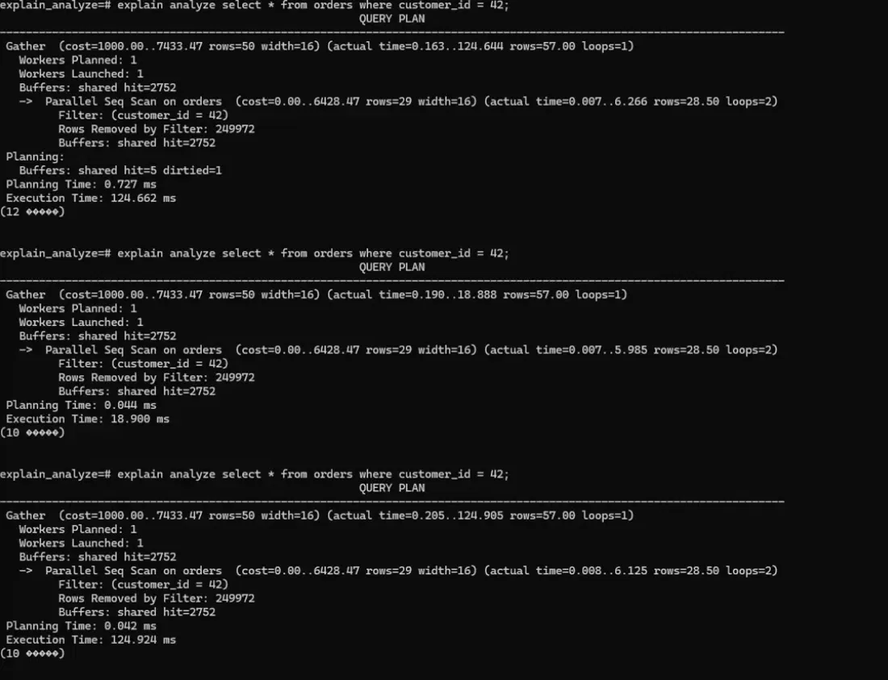
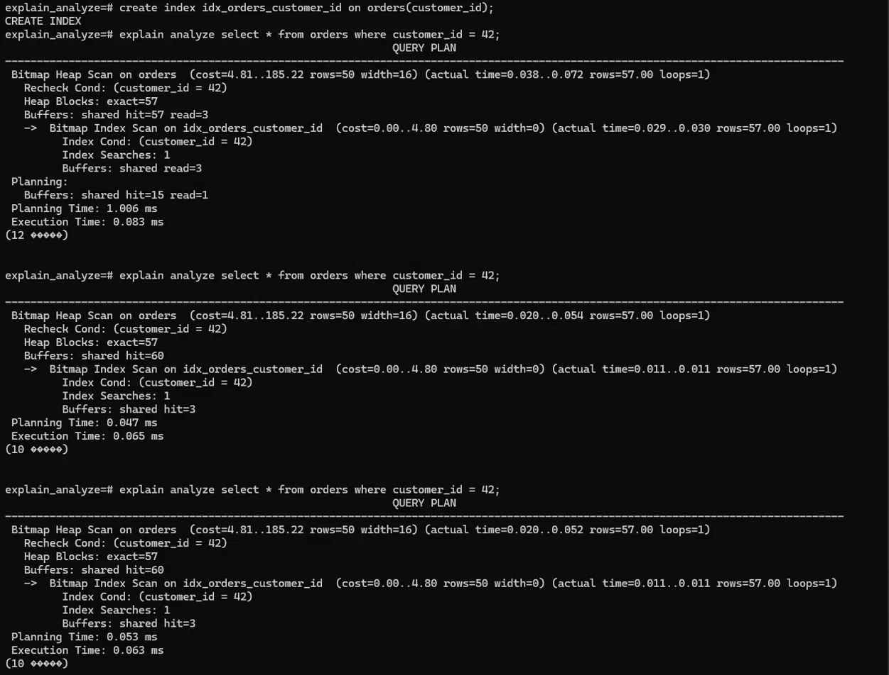

# Индексы и EXPLAIN ANALYZE

## Данные
Таблица `orders` с 500 000 строк, сгенерированных через `generate_series`.

## Запрос
```sql
select * from orders where customer_id = 42;
```

## Результаты

Execution Time (500 000 строк)
- Без индекса: 5 запусков, среднее 83.7 мс (min 18.1, max 131.9)
- С индексом: 5 запусков, среднее 0.07 мс (min 0.063, max 0.083)

Буферы: 2752 без индекса против 60 с индексом.

## Вывод
Индекс заменил Parallel Seq Scan на Bitmap Index Scan + Bitmap Heap Scan. Разброс без индекса, вероятно, связан с параллельными воркерами и нагрузкой на машину: буферы при этом одинаковые.


