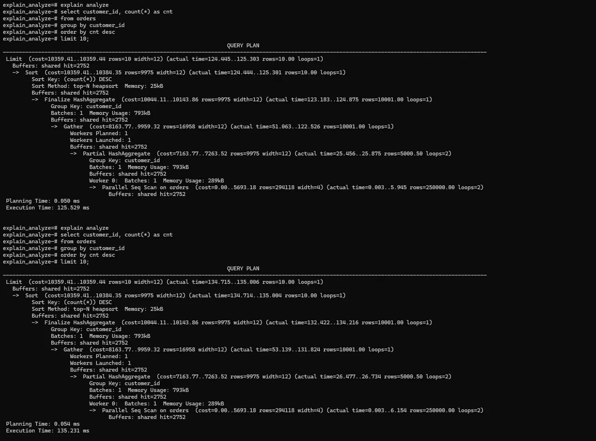
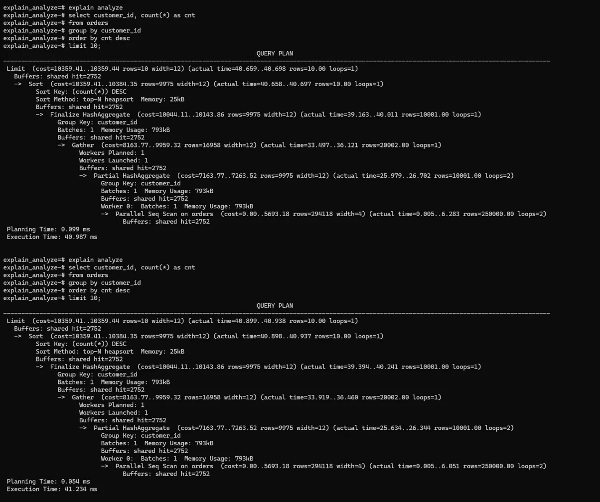
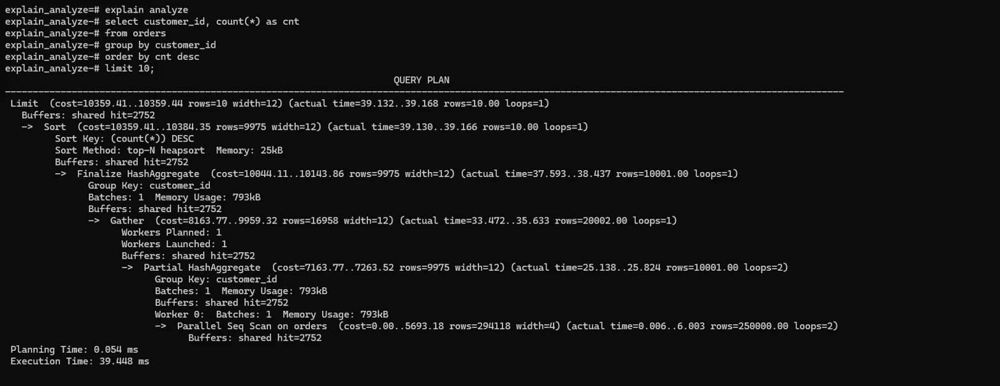
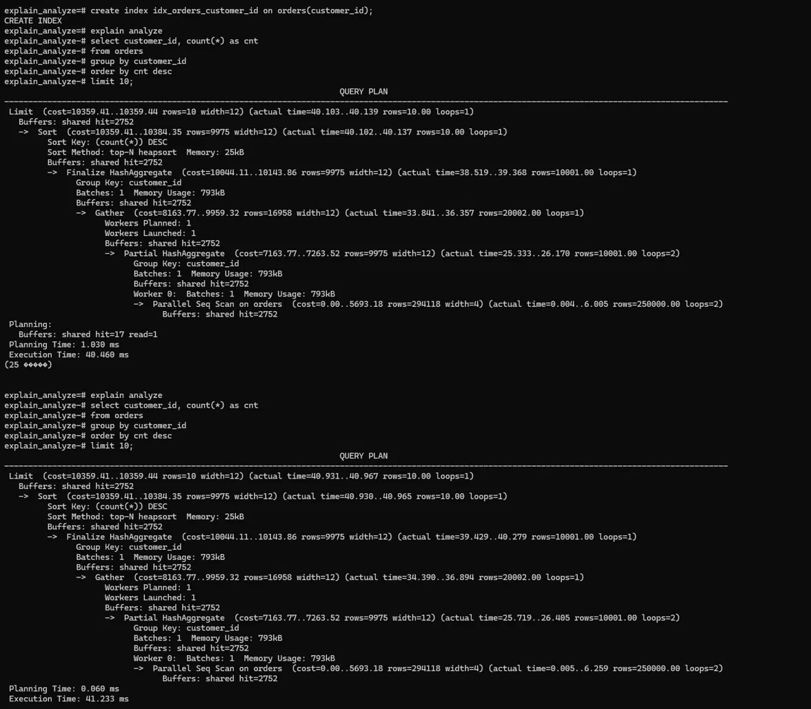
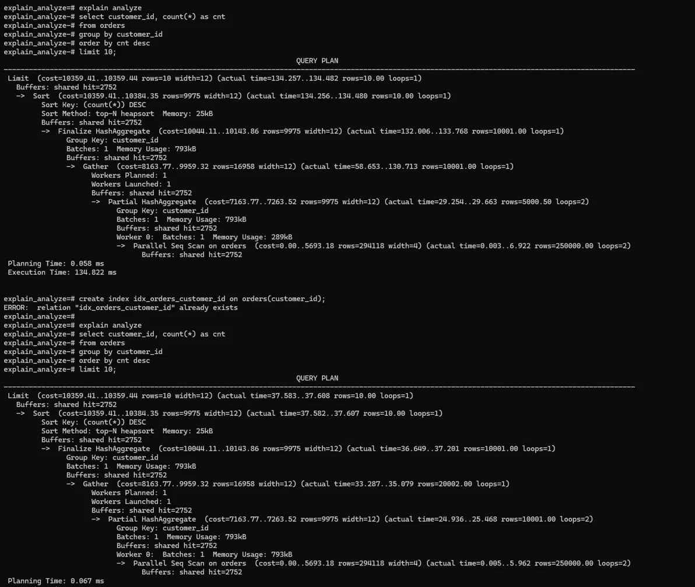
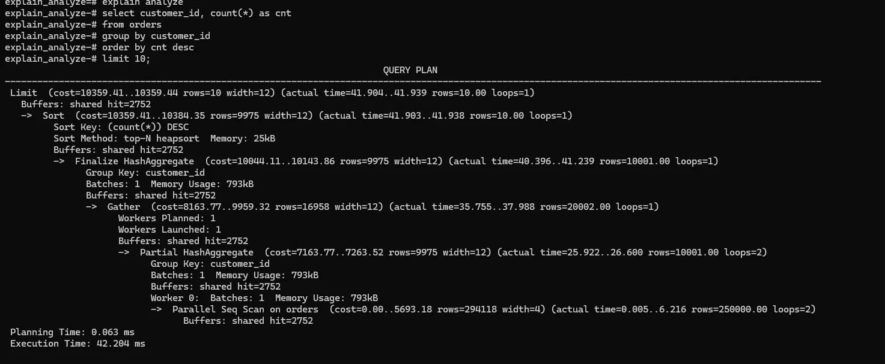

# GROUP BY и индекс: EXPLAIN ANALYZE

## Данные
Таблица `orders` с 500 000 строк, сгенерированных через `generate_series`. Та же таблица, что в кейсе с индексом по `customer_id`.

## Запрос
```sql
explain analyze
select customer_id, count(*) as cnt
from orders
group by customer_id
order by cnt desc
limit 10;
```

## Результаты

Execution Time, мс (5 запусков в каждой серии):

| Серия       | 1       | 2       | 3      | 4       | 5       | Среднее | Медиана |
|-------------|---------|---------|--------|---------|---------|---------|---------|
| Без индекса | 125.529 | 135.231 | 40.987 | 41.234  | 39.448  | 76.5    | 41.2    |
| С индексом  | 40.460  | 41.233  | 37.822 | 42.204  | 134.822 | 59.3    | 41.2    |

Буферы: 2752 без индекса и 2752 с индексом, то есть объём чтения не изменился.

## Вывод
Индекс не ускорил этот запрос. В обоих случаях план остался `Parallel Seq Scan` с `HashAggregate` и `Sort`, индекс не использовался.

Запрос считает количество строк для каждого `customer_id` по всей таблице, поэтому почти все строки нужны и без индекса. Переход по индексу для каждой строки обошёлся бы дороже, чем последовательное чтение.

Без индекса время сильно колеблется: от 39 до 135 мс. С индексом один запуск (134.8 мс) резко выбивается из остальных. Медиана в обеих сериях одинаковая (41.2 мс), поэтому разница в средних связана с выбросами, а не с работой индекса. Разброс, вероятно, связан с нагрузкой на машину, так как буферы при этом одинаковые.






