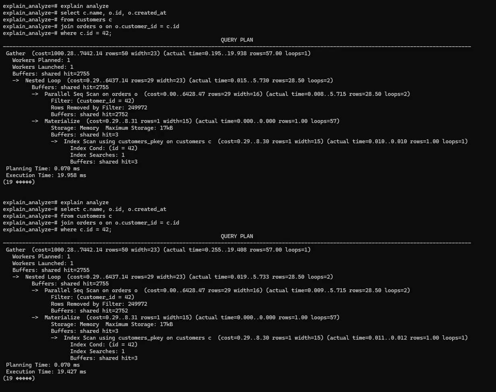
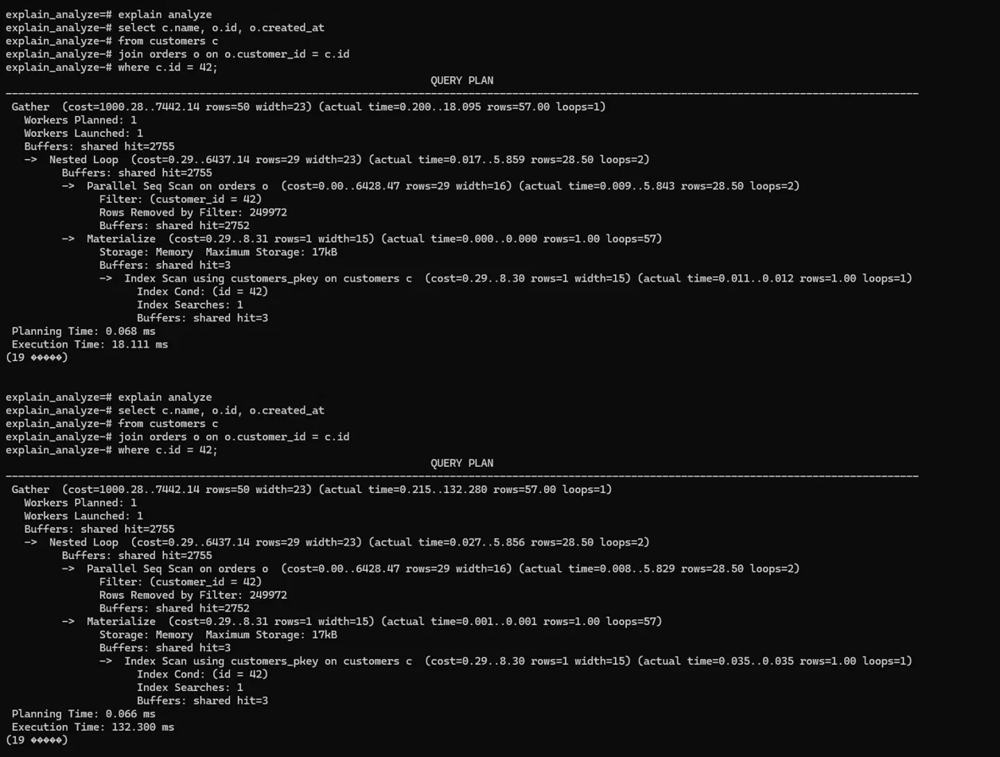
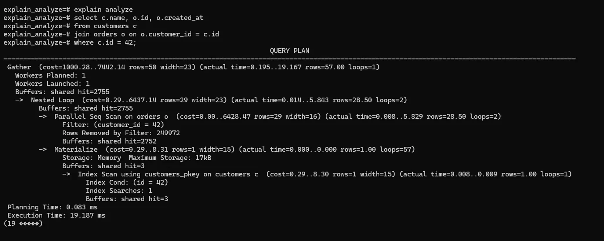
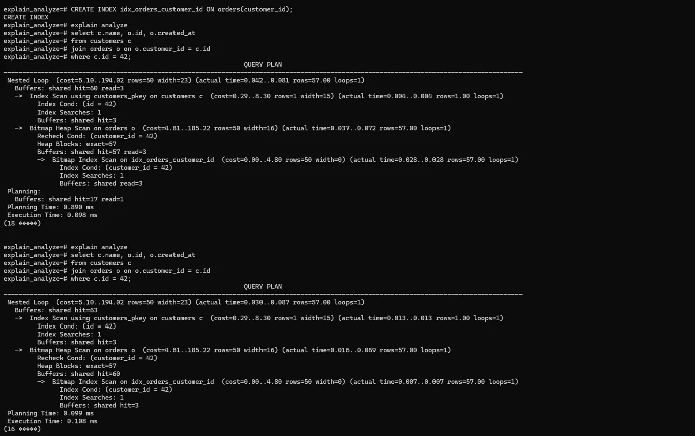
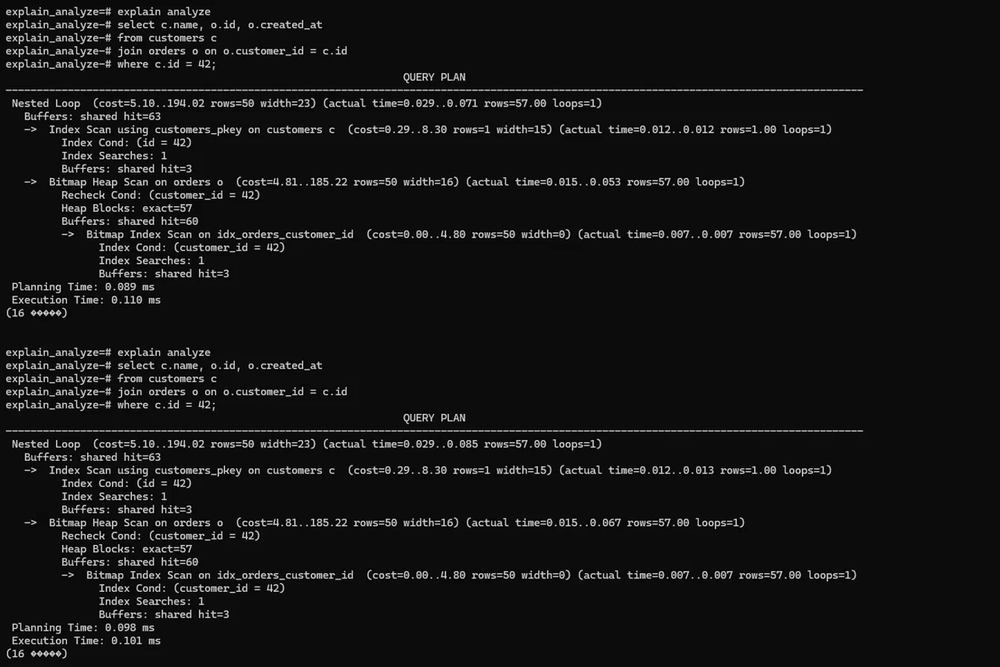
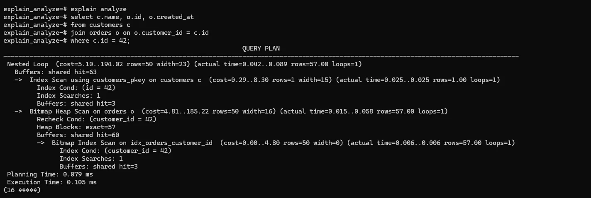

# JOIN и индекс: EXPLAIN ANALYZE

## Данные
Таблица `orders` с 500 000 строк и таблица `customers` с 10 001 строкой. `customers.id` является первичным ключом. Индекс на `orders.customer_id` создаётся только во второй серии замеров.

## Запрос
```sql
explain analyze
select c.name, o.id, o.created_at
from customers c
join orders o on o.customer_id = c.id
where c.id = 42;
```

## Результаты

Execution Time, мс (5 запусков в каждой серии):

| Серия       | 1       | 2       | 3       | 4       | 5       | Среднее | Медиана |
|-------------|---------|---------|---------|---------|---------|---------|---------|
| Без индекса | 19.958  | 19.427  | 18.111  | 132.300 | 19.187  | 41.8    | 19.4    |
| С индексом  | 0.098   | 0.108   | 0.110   | 0.101   | 0.105   | 0.104   | 0.105   |

Буферы: 2755 без индекса и 63 с индексом.

## Вывод
Индекс на `orders.customer_id` заметно ускорил запрос: медиана снизилась с 19.4 мс до 0.105 мс, примерно в 185 раз.

Без индекса внешний цикл `Nested Loop` читает `orders` через `Parallel Seq Scan` и отбрасывает почти все строки фильтром. Таблица `customers` при этом читается по первичному ключу, одна строка. После создания индекса планировщик меняет порядок обхода: сначала берёт строку из `customers` по `customers_pkey`, а `orders` читает через `Bitmap Index Scan` и `Bitmap Heap Scan`. Параллельное чтение и `Gather` пропали, потому что читать всю таблицу больше не нужно.

В серии без индекса один запуск (132.3 мс) выбивается из остальных. Буферы и план в нём такие же, как в остальных, поэтому, скорее всего, причина в нагрузке на машину, а не в запросе. Медиана обеих серий показывает обычное время выполнения.






